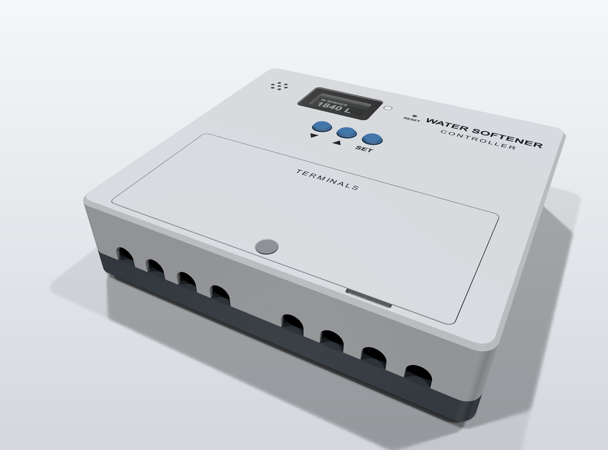
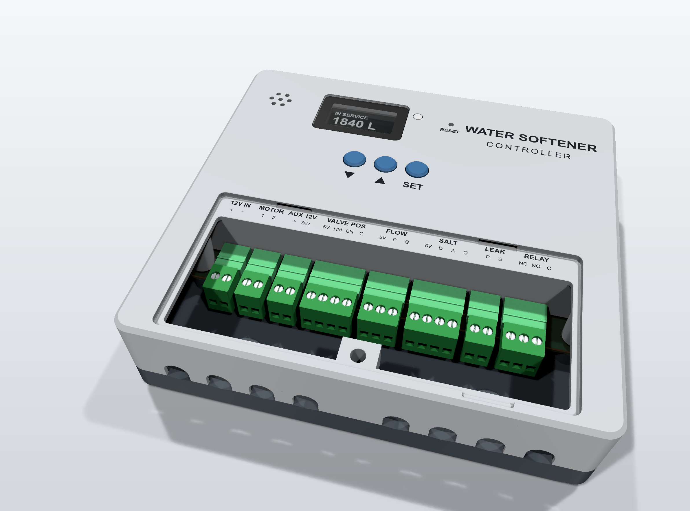
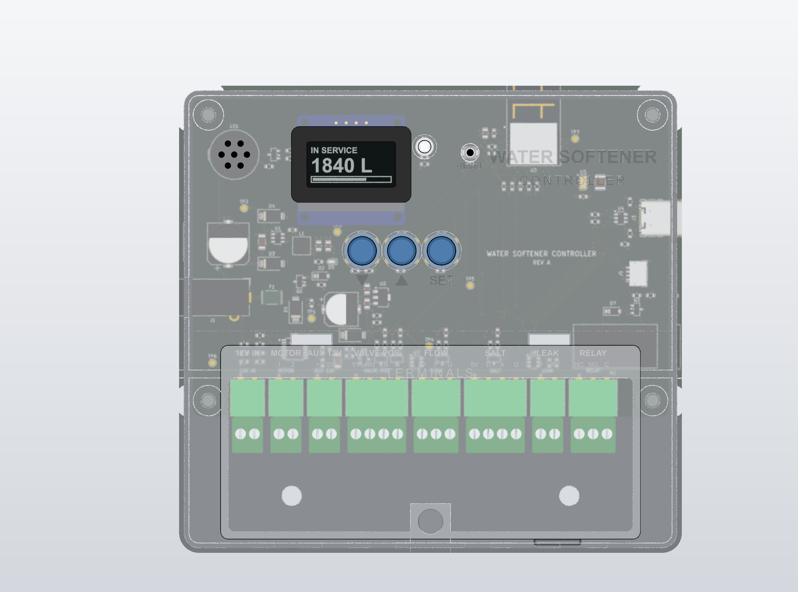
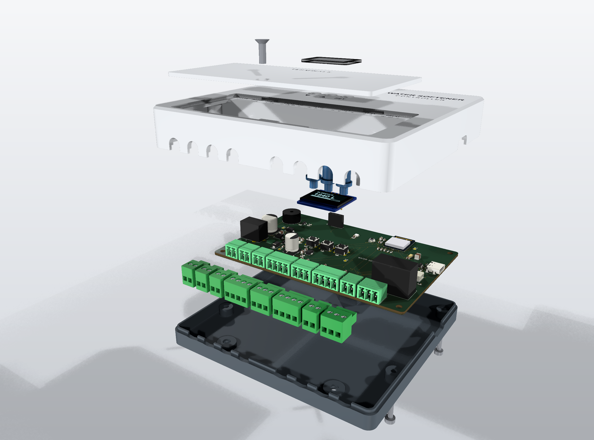

# Water Softener Controller (rev A)

> [!WARNING]
> **Design only: not built, not tested, not reviewed by an engineer.**
> Low voltage (12 V DC) only. The relay and the field wiring are not isolated or
> rated for mains. If you build it, check everything yourself first; start with
> [Open items](#open-items).

Full film: [`output/product/water_softener_controller.mp4`](output/product/water_softener_controller.mp4)
(21 s, 1280 x 720, no sound).

| Closed | Wiring bay open | See-through | Exploded |
|---|---|---|---|
|  |  |  |  |

Control board for a metered (demand-initiated) water softener valve. An ESP32-C6
drives the valve motor through the regeneration positions, counts treated water
from a turbine flow meter, watches salt level and a leak probe, and keeps time
through power cuts. Supply is 12 V DC.

The project holds the schematic, a first-pass board layout (120 x 80 mm,
4 layers) and a wall-mount enclosure with a wiring bay (127 x 118 x 29 mm). The
layout passes KiCad's design rule check and the enclosure passes a collision
check against the board, but nothing has been reviewed by a layout or mechanical
engineer, built or printed; see "Open items" before ordering anything.

## How this was made

Everything here was produced by Claude Fable 5.2 (Anthropic's model, working in
Claude Code) from a handful of short prompts: the circuit, the board layout and
the router that produced it, the enclosure, the renders and the film. No
engineer has reviewed any of it. Treat it as a demonstration of a hardware
design that rebuilds from scripts, not as a design to build as it stands.

## Files

| Path | What it is |
|---|---|
| `water_softener.kicad_pro`, `water_softener.kicad_sch` | KiCad 10 project and root sheet |
| `power.kicad_sch`, `mcu.kicad_sch`, `drive.kicad_sch`, `sensors.kicad_sch` | The four circuit sheets |
| `water_softener.kicad_sym`, `sym-lib-table` | Project symbol library (DRV8876PWP) |
| `water_softener.kicad_pcb`, `water_softener.kicad_dru` | Board layout and one custom DRC rule |
| `3d/` | Simple 3D bodies for parts KiCad has no model for (module, relay, jack, fuse, RTC, status LED) |
| `enclosure/enclosure.scad` | Enclosure model (OpenSCAD). `board.scad` beside it is written from the board layout |
| `enclosure/stl/` | Parts to print or cut: base, cover, door, button, light pipe, display window |
| `3d/enclosure/` | The same parts, plus stand-ins for display, plugs and screws, as models for the renders |
| `output/water_softener_schematic.pdf` | Schematic, 5 pages |
| `output/sheets/*.png` | One image per schematic sheet |
| `output/water_softener_bom.csv` | BOM: 59 lines, 111 parts |
| `output/water_softener.net`, `output/nets.txt`, `output/erc.json` | Netlist, net summary, ERC report |
| `output/pcb/*.png` | Board renders (top, bottom, angled) and the outer copper layers |
| `output/product/*.png` | The assembled product: front, two angles, rear, wiring bay open, cover off, see-through, exploded |
| `output/product/water_softener_controller.mp4` | 21-second presentation film, 1280 x 720, no sound |
| `output/product/water_softener_controller_x.mp4` | The same film with a different closing card (`scripts/video.py --closing`), as posted on X |
| `output/product/assembly_parts.csv` | Printed parts and bought hardware for one unit |
| `output/product/clearance.txt` | Result of the collision check between enclosure and board |
| `output/water_softener_drc.json` | Board DRC report |
| `docs/preview.gif` | Small animated preview of the film for this page |
| `LICENSE`, `LICENSES/` | Licence summary and the two licence texts |
| `scripts/` | Source of everything above |

Schematic, board and enclosure are written by scripts:

    python3 scripts/build.py              # schematic, ERC, PDF, BOM (a few seconds)
    python3 scripts/build.py --pcb        # the same, then place, route and check the board (about 2 minutes)
    python3 scripts/build.py --product    # the same, then enclosure parts, collision check and renders (about 5 minutes)
    python3 scripts/build.py --video      # the same, then the presentation film (about 30 minutes the first time)

`--product` works on the board file as it is; add `--pcb` to rebuild the board
first. It needs OpenSCAD on the PATH. `--video` needs ffmpeg and the enclosure
models from `--product`; it ray-traces about 500 frames and keeps them in the
system's temporary folder, so a repeat run only renders what changed.

Needs KiCad 10 (tested with 10.0.8), Python 3.9 or later with `pypdf`,
`pdftoppm` (poppler) for the sheet images, OpenSCAD with the Manifold backend
(a 2025 or later build) for the enclosure, and ffmpeg for the film. The
enclosure and film steps run in the Python that has `pcbnew` and also need
numpy and Pillow there; KiCad's macOS bundle includes both.

Tested on macOS only. KiCad is looked up in the usual macOS and Linux places;
set `KICAD_SHARE`, `KICAD_CLI` and `KICAD_PYTHON` if it is somewhere else. The
copper-layer picture needs macOS Quick Look and is skipped elsewhere, and the
film's captions use macOS fonts.

`design.py` holds the circuit, `pcb_layout.py` the board outline, part positions,
net classes and planes, `pcb_route.py` the router and `enclosure/enclosure.scad`
the enclosure. Edit there and rebuild, or edit in KiCad and stop using the
scripts; doing both will overwrite the KiCad edits.

## Blocks

| Block | Main parts | Notes |
|---|---|---|
| 12 V input | J1 barrel jack, J2 terminals, F1 1.5 A PTC, D1 SMAJ16CA, Q1 DMP3099L | Reverse-polarity FET, surge clamp at 26 V |
| Logic supply | D3/D4 SS14, U1 AP63203 (3.3 V, 2 A buck), C3 470 uF | `VSYS` is the diode-OR of +12V and USB VBUS |
| Sensor supply | U2 L78L05 | +5V for field sensors only, about 50 mA continuous |
| MCU | U3 ESP32-C6-MINI-1-N4 | Wi-Fi 6, BLE 5, 802.15.4; all 22 GPIOs used |
| USB-C | J3, U4 USBLC6-2SC6 | Native USB Serial/JTAG for flashing and debug |
| Clock | U5 RV-3028-C7, C15 11 mF backup | Keeps time for days without power |
| User interface | J4 OLED socket, SW2-SW4, D6 RGB LED, LS1 piezo, J5 Qwiic | |
| Valve motor | U6 DRV8876 H-bridge | 1.0 A current limit, analog current feedback |
| Outputs | K1 SPDT relay, Q4 switched 12 V | Alarm / interlock, solenoid or shut-off valve |
| Inputs | Q5-Q8 pass FETs, U7/U8 USBLC6-4SC6 | Valve position x2, flow, salt UART, leak probe |

## Connectors

| Ref | Function | Pins |
|---|---|---|
| J1 | 12 V DC in, 5.5 x 2.1 mm | centre positive |
| J2 | 12 V DC in, terminals | 1 +12 V, 2 GND |
| J3 | USB-C | service port |
| J4 | OLED module socket | 1 GND, 2 3V3, 3 SCL, 4 SDA |
| J5 | Qwiic I2C | 1 GND, 2 3V3, 3 SDA, 4 SCL |
| J6 | Valve motor | 1 OUT1, 2 OUT2 |
| J7 | Relay contacts | 1 NC, 2 NO, 3 COM |
| J8 | Switched 12 V output | 1 +12 V, 2 switched to GND |
| J9 | Valve position | 1 +5 V, 2 HOME, 3 ENC, 4 GND |
| J10 | Flow meter | 1 +5 V, 2 PULSE, 3 GND |
| J11 | Salt level sensor (UART) | 1 +5 V, 2 DATA (sensor TX), 3 AUX, 4 GND |
| J12 | Leak probe | 1 PROBE, 2 GND |

J2 and J6-J12 are Phoenix MC 1,5/x-G-3,5 pluggable headers.

## GPIO map

| GPIO | Net | Use |
|---|---|---|
| 0 | VIN_SENSE | ADC, 0.130 x V(+12V) |
| 1 | MOTOR_ISENSE | ADC, 2.49 V per amp |
| 2 | LEAK_SENSE | ADC, 3.3 V dry, falls when wet |
| 3 | FLOW_PULSE | Flow meter pulses (pulse counter) |
| 4 | BTN_UP | Active low |
| 5 | RELAY_DRV | High = relay on |
| 6 / 7 | I2C_SDA / I2C_SCL | RTC 0x52, OLED, Qwiic |
| 8 | LED_DIN | WS2812B data; strap, pulled high |
| 9 | BTN_SET | Active low; also the BOOT strap |
| 12 / 13 | USB_D_N / USB_D_P | USB Serial/JTAG |
| 14 | BUZZER_DRV | PWM about 4 kHz |
| 15 | AUX_DRV | High = 12 V output on; strap, pulled low |
| 16 | U0TXD | DOWN button through 1 k; ROM boot log on TP7 |
| 17 | SALT_RX | UART RX from the salt sensor |
| 18 / 19 | MOTOR_IN1 / MOTOR_IN2 | 10 forward, 01 reverse, 11 brake, 00 coast |
| 20 | MOTOR_nSLEEP | High = driver enabled (pulled low) |
| 21 | MOTOR_nFAULT | Low = over-current or over-temperature |
| 22 / 23 | POS_HOME / POS_ENC | Active low |

## Design values

- Motor current limit: I = VREF / (R23 x 1000 uA/A) = 2.48 V / 2.49 k = 1.0 A.
  Change R23 to rescale; keep VREF x R23 so that full scale stays under 3.3 V.
- Supply budget at 12 V: motor running 0.2-0.4 A (1.0 A at stall), switched output
  up to 0.5 A, relay 33 mA, logic about 0.1 A. F1 holds 1.5 A, so limit stall time
  in firmware when the switched output is also loaded.
- Hold-up: C3 gives roughly 60 ms at idle after +12V collapses, 20 ms during Wi-Fi
  transmit. Enough to stop the motor and store the cycle step.
- Digital inputs take open-collector, switch or 5 V push-pull sources. Pull-ups are
  2.2 k to 3.3 V (1.5 mA contact current).
- Leak input: 470 k pull-up. A wet probe of 100 k or less reads below 0.6 V.

## What firmware has to do

- Raise `MOTOR_nSLEEP`, wait 1 ms, then drive IN1/IN2. Read `MOTOR_ISENSE` only
  while driving or braking; it reads zero in coast.
- Detect end stops and jams from current (near 2.5 V = at the limit) or from
  missing `POS_ENC` pulses, and stop within a few seconds.
- Below about 9 V on `VIN_SENSE`: stop outputs and save state. Near 0 V with the
  MCU alive means USB-only power; do not run the motor, relay or switched output.
- RV-3028 EEPROM register 37h: enable backup switchover and the trickle charger
  once at first boot. Disable CLKOUT.
- Use the USB Serial/JTAG console. Leave UART0 off so GPIO16 can read the DOWN
  button and GPIO17 can receive the salt sensor at 9600 baud.
- Holding SET while resetting enters the ROM download mode.

## Board

- 120 x 80 mm, 1.6 mm, four M3 holes on a 112 x 72 mm pattern. All parts on the top side.
- Layers: top signals / GND plane / power plane (+12V under the power and motor
  area, +3V3 elsewhere) / bottom signals.
- Field terminals along the bottom edge, 12 V jack on the left, USB-C on the
  right. The module sits at the top edge with its antenna flush to the edge and a
  copper-free strip either side.
- The OLED module plugs into J4 and covers roughly x 26-54, y 4-32 mm of the
  board. Only low parts are placed under it.
- Net classes: signals 0.2 mm, power 0.4 mm, 12 V input and VSYS 0.8 mm, relay
  contacts 1.2 mm with 0.4 mm clearance. Vias 0.6/0.3 mm and 0.8/0.4 mm.
- Routing is automatic (`scripts/pcb_route.py`) except the USB-C escape, which is
  placed by hand: the connector's D+ and D- pads interleave, so the outer pair
  goes round the ESD array U4 and returns on the bottom layer.
- Decoupling and supply pins connect to the planes with a via each; the bulk
  capacitors, buck and switch FETs get two.

## Enclosure

- Outside 126.8 x 117.8 x 28.8 mm; the buttons stand 1 mm proud. Three printed
  shells: base, cover and the door of the wiring bay.
- Front: display window, three buttons (down, up, SET) on the tact switches, a
  light pipe over the status LED, sound holes over the sounder and a pin hole
  over the RESET switch.
- The lower part is the wiring bay. The terminal headers and their plugs sit in
  it behind a door held by two tabs and one screw. A strip above the terminals,
  covered by the door, names each terminal block and pin. Eight cable entries
  in the bottom wall. A partition closes the bay off from the electronics.
- USB-C opening in the right wall (sized for the plug's overmould), 12 V jack in
  the left wall.
- Four M3 screws from the rear clamp base, board and cover together: bosses
  under the board, posts with threaded inserts above it. Three pillars support
  the board under the buttons.
- Wall fixing: a keyhole slot at the top of the rear and two screw holes in the
  floor of the wiring bay.
- The board sits 5 mm above the floor, with 17.8 mm of headroom above it (the
  relay is 15.8 mm tall).

Assembly:

1. Press the five M3 inserts into the four cover posts and the door block.
2. Glue the display window into its recess. With the cover face down, drop the
   light pipe and the three buttons into their sleeves; their flanges keep them
   in once the board is fitted.
3. Plug the OLED module into J4, lay the board onto the cover posts, put the
   base on and fit the four M3 x 12 screws from the rear.
4. Hang the unit on the top wall screw and fix it with two screws through the
   wiring bay.
5. Feed the cables through the bottom entries, wire the plugs, plug them in and
   close the door.

`output/product/assembly_parts.csv` lists the printed parts and the hardware.
Print the base floor down and the cover face down. On the cover, the seat for
the door (label strip, screw block and the pockets for the door tabs) sits
1.8 mm above the bed and needs support. The keyhole pocket in the base is an
11 mm bridge.

## Checked

- KiCad 10.0.8 ERC: 0 errors, 0 warnings on all sheets.
- Every footprint name exists in the stock KiCad libraries.
- Netlist read through net by net against the intended circuit (`output/nets.txt`).
- Against datasheets: DRV8876 PWP pinout, mode pins and 1000 uA/A sense gain;
  AP63203 pinout and component values; ESP32-C6 strapping pins, ADC pins, USB pins
  and reset RC; RV-3028-C7 pin handling.
- Board DRC (KiCad 10.0.8, planes refilled): 0 errors, 0 unconnected items, 0
  differences from the schematic. 20 warnings remain, all for connector
  silkscreen that reaches the board edge.
- Enclosure against board: the build exports the board with its 3D part
  models, samples every surface and tests the points against the enclosure
  solids on a 0.2 mm grid. No part of the board touches the base, cover, door or
  window, and every component keeps at least 0.3 mm from the plastic. The same
  test covers the display module, the wired plugs, buttons and light pipe, and
  the fit of cover, door and window to each other. Result in
  `output/product/clearance.txt`. The check was tried on deliberately wrong
  enclosures: with the ceiling 2.5 mm lower it reports the relay, with 1 mm
  standoffs it reports the through-hole pins, and it reports the sounder's
  leads if they are left untrimmed.
- One DRC rule is relaxed in `water_softener.kicad_dru`: the USB-C receptacle's
  locating pegs sit 0.19 mm from its own ground pads (the manufacturer's land
  pattern), against the board-wide 0.25 mm hole clearance.

## Open items

Parts and circuit:

1. C15 (Seiko CPH3225A) uses the generic 1210 footprint. Confirm against the Seiko
   land pattern.
2. U6 footprint is the HTSSOP-16 PowerPAD variant with a 3 x 3 mm mask opening,
   chosen for TI package PWP0016A (3.3 mm pad). Confirm against the drawing.
3. The 1.0 A motor limit is an assumption. Measure the real valve motor and set R23.
4. D6 must be the WS2812B-2020 V6 revision; earlier ones are not rated at 3.3 V.
5. J4 pin order suits the common GND-VCC-SCL-SDA OLED modules. Some swap GND and VCC.
6. J11 assumes a UART ultrasonic sensor of the A02YYUW type; match the pinout to
   the sensor chosen.
7. L1 is 4.7 uH; the AP63203 datasheet table lists 3.9 uH and allows 2.2-10 uH.
8. Relay contacts and all field wiring are for low voltage only (30 V, 3 A). The
   board has no mains isolation.
9. EMC and safety compliance have not been assessed.

Board, before fabrication:

1. The layout is autorouted and unreviewed. Routes are electrically complete and
   rule-clean, not tidy: expect long diagonals and more vias than a hand layout.
2. Supply copper is minimal. The 12 V path (J1, F1, Q1, C1) and the buck loop
   (U1, C4, L1, C6/C7) would benefit from copper pours and more vias.
3. Some bottom-layer signals cross the split between the +12V and +3V3 planes.
   Harmless at these speeds, worth tidying.
4. No outer-layer ground pours and no stitching vias.
5. Reference designators are on the silkscreen only for ICs, connectors, switches
   and test points; resistors and capacitors need the assembly drawing (F.Fab).
6. Check the mechanical fit of the OLED module, the jack and USB-C overhang, and
   the mounting holes against the enclosure.
7. The 3D bodies in `3d/` are plain boxes for the renders, not accurate models.
8. No Gerber, drill or placement files have been exported yet.

Enclosure, before printing a batch:

1. Nothing has been printed or test-fitted. Mating parts have 0.15-0.2 mm of
   clearance (`fit` in `enclosure.scad`); tune it for the printer and material.
2. OLED modules differ between vendors. The window assumes a 27.3 x 27.8 mm
   module with the middle of the display 10.5 mm below the header row. Measure
   the module in hand and adjust `oled_view`. The module is held only by its
   header; add a foam pad or standoffs under its free end.
3. The relay, jack, module and plugs are box stand-ins sized from their
   datasheets, and the sounder's leads are assumed trimmed to 2.5 mm under the
   board. Check the real parts against the cover before committing.
4. Not sealed. Connector openings and cable entries are open, so this is for a
   dry indoor wall, away from spray and salt. A damp plant room needs gaskets
   and cable glands, or an off-the-shelf IP65 box.
5. No strain relief for the field cables, and unused cable entries stay open.
6. Heat inside the closed box has not been estimated or measured.
7. The legends are engraved 0.3 mm deep; the dark fill in the renders stands
   for paint or a printed label. The window needs black print on its back
   round the display area, as drawn.
8. STL meshes only. OpenSCAD cannot write STEP, so there are no CAD solids of
   the enclosure for further work in a mechanical CAD program.

## Licence

Software under `scripts/` is MIT. The hardware design (the KiCad files,
`enclosure/`, `3d/` and `output/`) is CERN-OHL-P v2. Both are permissive and
come without warranty of any kind. See `LICENSE`.
